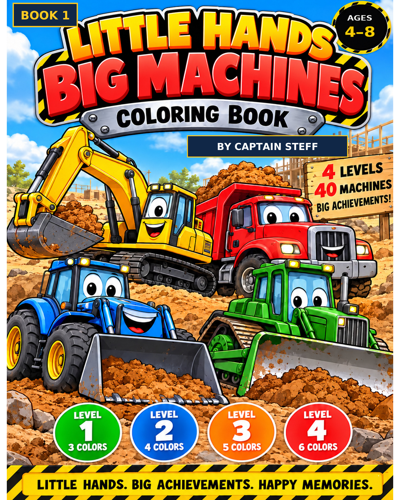
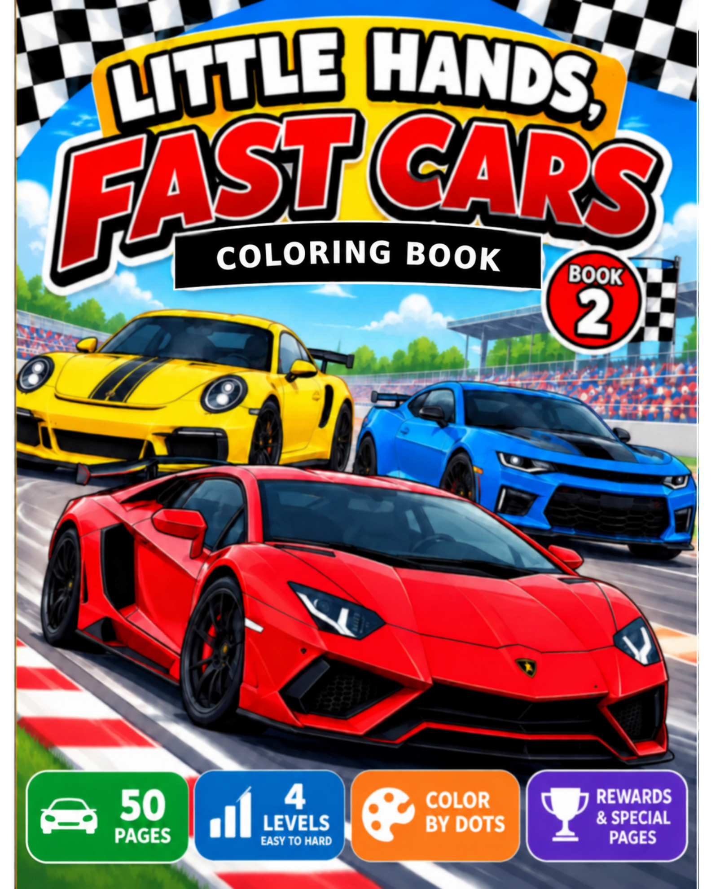
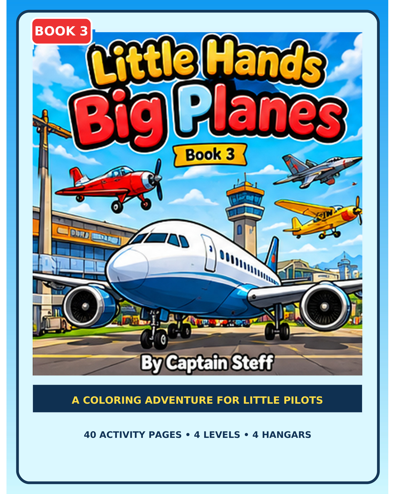
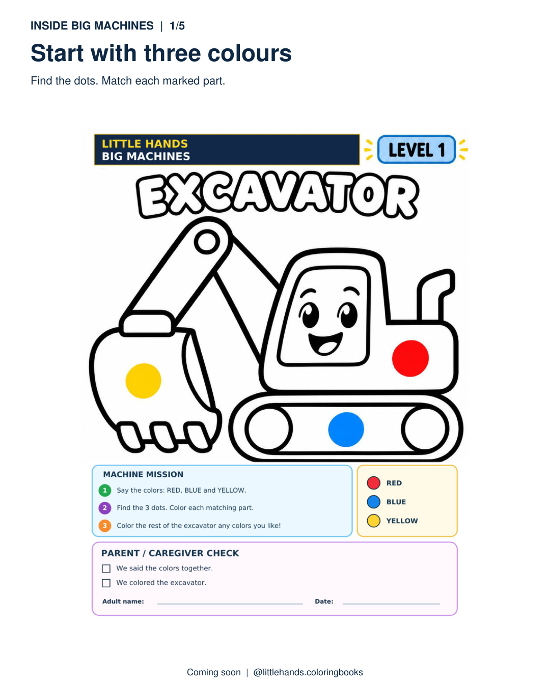
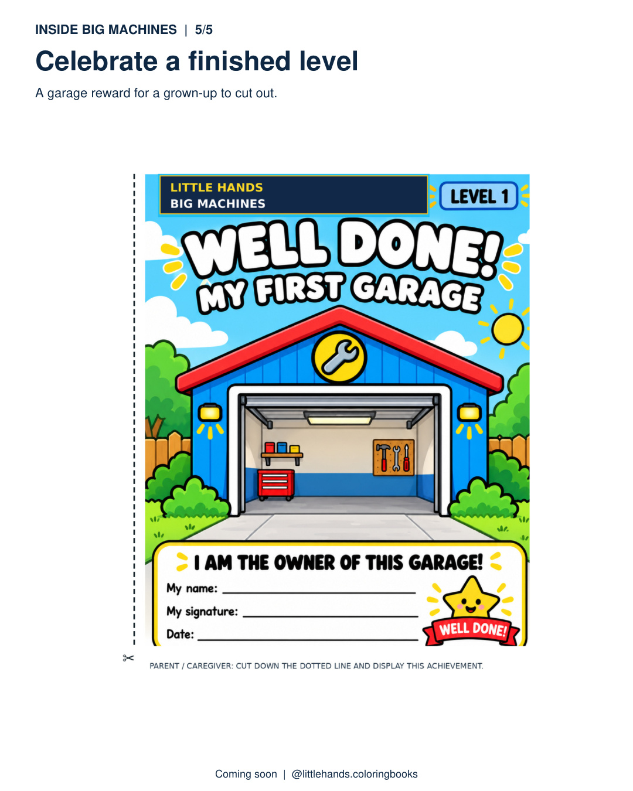
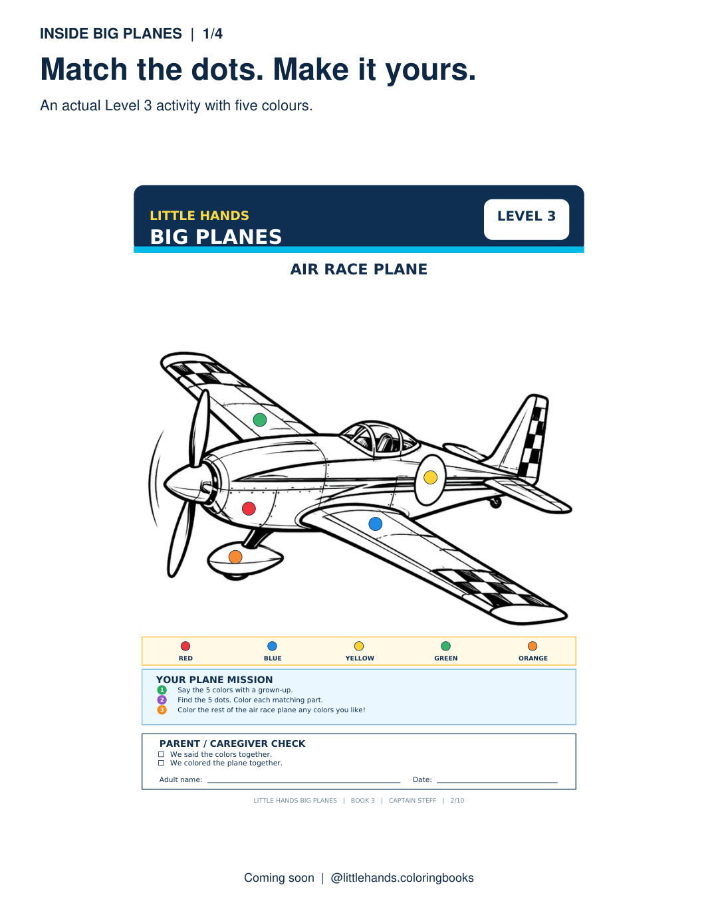
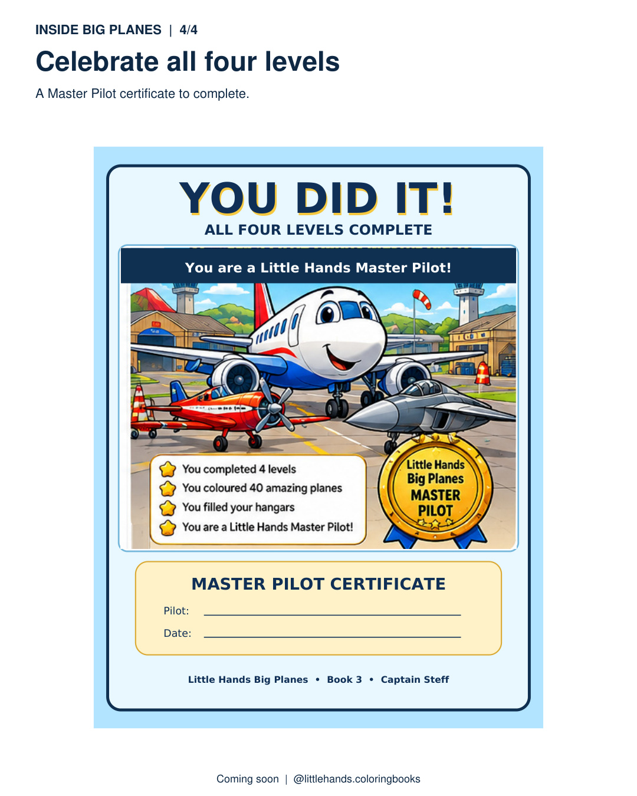

# Little Hands Coloring Books

**Real vehicle colouring activities. Four progressive colour-by-dots levels. Completion rewards.**

**Explore the books and their real approved page previews:** [Little Hands collection](index.html) · [Big Machines construction vehicle colouring](big-machines.html) · [Big Planes airplane and helicopter colouring](big-planes.html) · [Fast Cars racing car colouring](fast-cars.html).

From **Captain Steff**, the *Little Hands* books let young vehicle fans find the coloured dots, match the marked parts of the picture, then choose their own colours for the rest. Each book progresses through **3, 4, 5 and 6 colour cues**. Adults can help children cut out completion rewards.

## Buy the three books

| 🚜 Little Hands Big Machines | 🏎️ Little Hands Fast Cars | ✈️ Little Hands Big Planes |
| :---: | :---: | :---: |
|  |  |  |
| Trucks, diggers and working machines; garage rewards | Racing cars across four levels; garage rewards | Aircraft activities; hangar rewards and a Master Pilot certificate |
| **[Big Machines on Amazon](https://www.amazon.com/dp/B0HQ1CDZ77)** | **[Fast Cars on Amazon](https://www.amazon.com/dp/B0HQYS1XXW)** | **[Big Planes on Amazon](https://www.amazon.com/dp/B0HPZVLV5T)** |

### Look inside: actual activity pages

These preview images come from our books' approved promotional materials. They show real page content, not simulated customer results.

| Big Machines — start with three colours | Big Machines — Level 1 garage reward |
| :---: | :---: |
|  |  |

| Big Planes — five-colour aircraft challenge | Big Planes — Master Pilot certificate |
| :---: | :---: |
|  |  |

**For parents and educators:** [Try our free three-colour vehicle spotting activity](editorial/vehicle-colour-spotting-activity.md) — a short original idea that works with any vehicle picture. No purchase required.

### How colour-by-dots works

1. Find the coloured dots on parts of the vehicle picture.
2. Match those colours to the marked parts.
3. Finish the rest of the picture using your own colours.
4. Explore the next level when ready; celebrate completed levels with the book's reward pages.

**[See a real Big Machines activity demonstration](https://www.facebook.com/reel/1596833824988739/)** · **[See the four-level Big Machines preview](https://www.instagram.com/p/DfKAKkSjhds/)** · **[See the Big Planes preview](https://www.instagram.com/p/DfKCru7CCb-/)**

### Follow Little Hands

- [TikTok — @littlehandscoloringbooks](https://www.tiktok.com/@littlehandscoloringbooks)
- [Facebook — Little Hands Coloring Books](https://www.facebook.com/littlehands.coloringbooks/)
- [Instagram — @littlehands.coloringbooks](https://www.instagram.com/littlehands.coloringbooks/)

*Preview images are for demonstration, not printable interior downloads. This repository contains public promotional material only; it does not contain private customer, sales or publishing-account data.*
