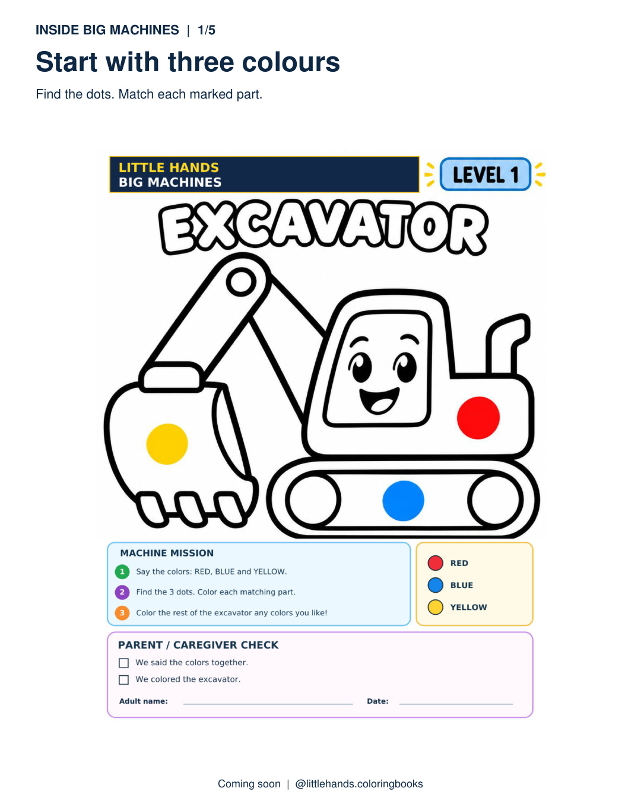
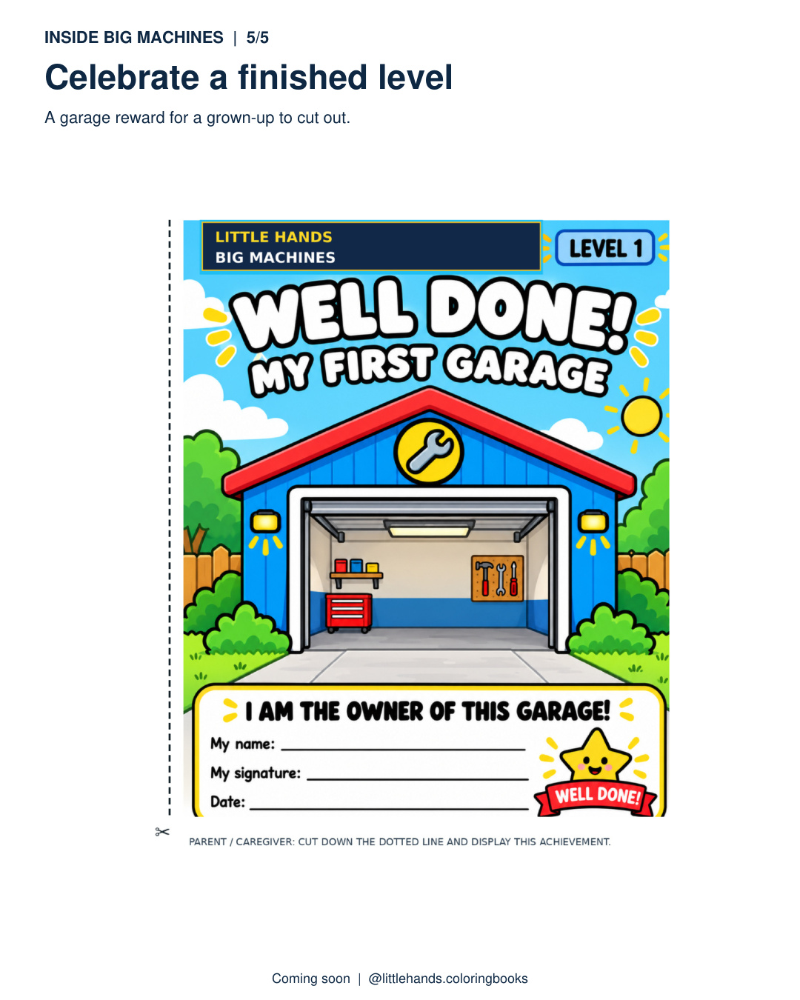
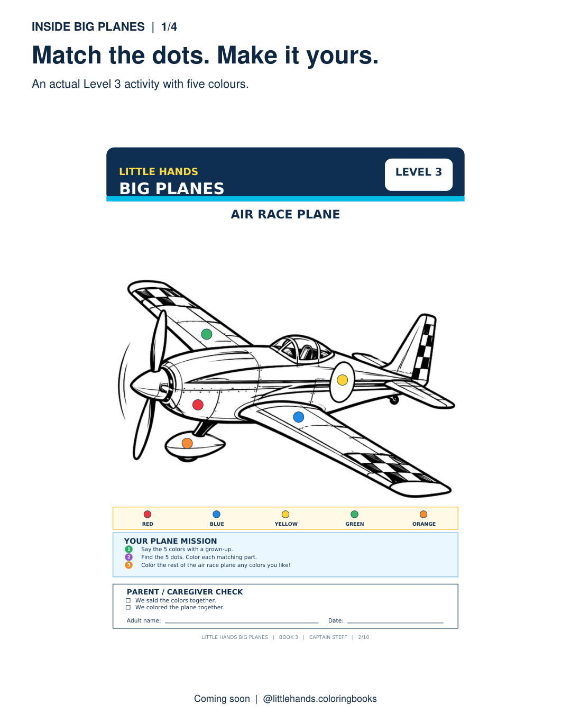
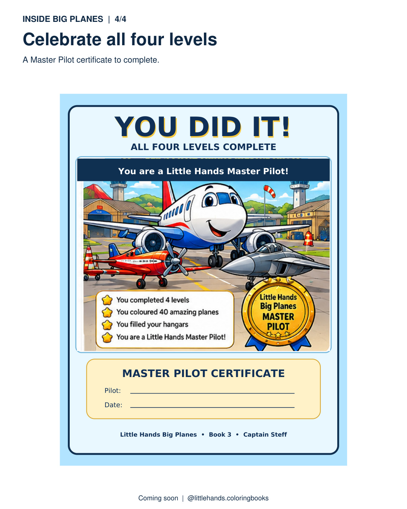

# A free vehicle colour-spotting activity for families and preschool groups

**An original, simple activity idea shared by Little Hands Coloring Books (Captain Steff).** Suitable for parents, grandparents, playgroup leaders and early-years educators who want a vehicle-themed, screen-free colouring prompt. This page is an original editorial resource from the book publisher, **not** a customer review or independent endorsement.

## The activity: spot three colours, then invent the rest

**Materials:** any vehicle outline picture, red/blue/yellow pencils or crayons, plus other colours the child chooses. An adult can draw or mark three small coloured dots on parts of the vehicle picture. You do **not** need to buy a Little Hands book to try this idea.

1. **Choose a favourite vehicle** — a digger, fire truck, bus or aircraft.
2. **Add three colour clues:** an adult puts a small red, blue and yellow dot on three different parts of the picture.
3. **Find and match:** together, spot each coloured dot and colour that marked section to match.
4. **Make the rest your own:** the child can freely choose colours for unmarked parts. Ask: *Which part was easiest to spot? What colour would you use next?*
5. **Celebrate the picture** — display the finished drawing somewhere the child likes.

**For a bigger challenge:** try four, five or six marked colours once the child wants to do more. Follow the child's interest and pace; there is no need to finish or cut out anything.

## What real Little Hands pages look like

These are **promotional previews of actual approved book pages**, not free printable PDFs. Please request permission before reproducing the images in another publication.

| Big Machines: three-colour starting point | Big Machines: garage reward page |
| :---: | :---: |
|  |  |

| Big Planes: more detailed aircraft activity | Big Planes: Master Pilot certificate |
| :---: | :---: |
|  |  |

The books use a four-level colour-by-dots progression (three, four, five, then six colour clues). Fast Cars adds black as a surprise seventh colour in Level 4, with garage completion rewards. Big Machines has completion garage rewards; Big Planes features hangar rewards and a Master Pilot certificate. An adult should help with any cut-out page.

## For parenting and education editors

This **original activity description** may be considered for an unpaid editorial mention after you review its suitability for your audience. We can explain the idea or supply approved sample imagery for a proposed feature. **Affiliation disclosure:** this resource is published by the company selling the books below. No editorial site or creator is claimed to have reviewed, endorsed or partnered with us. Any image use or full-page reproduction requires permission.

**Current Little Hands books by Captain Steff**

- [Little Hands Big Machines — paperback listing](https://www.amazon.com/dp/B0HQ1CDZ77)
- [Little Hands Big Planes — paperback listing](https://www.amazon.com/dp/B0HPZVLV5T)
- [Little Hands Fast Cars — paperback listing](https://www.amazon.com/dp/B0HQYS1XXW)

The links use our current edition identifiers. Amazon controls price, delivery and availability.

[Read the free activity on our website](https://little-hands-coloring-books.sublimecypress2.chatgpt.site/vehicle-colour-spotting).

More genuine page examples: [Big Machines](https://www.instagram.com/p/DfKAKkSjhds/) · [Big Planes](https://www.instagram.com/p/DfKCru7CCb-/). [Little Hands on Facebook](https://www.facebook.com/littlehands.coloringbooks/).

*No paid placement, review, educational outcome or customer sale is claimed by this document.*
